<!-- Cards are generated by scripts/build_assets.py - edit the content there and re-run. -->

<a href="https://0xbarbosa.dev"></a>





<a href="https://github.com/barbosaz1/xiux-ide"></a>
<a href="https://github.com/barbosaz1/cipheraimg"></a>
<a href="https://github.com/barbosaz1/xubz-theme"></a>
<a href="https://github.com/barbosaz1/cursed-calculators"></a>
<a href="https://github.com/barbosaz1/portfolio"></a>
<a href="https://github.com/barbosaz1/prototipo-coworking"></a>




<a href="https://github.com/barbosaz1"></a>
<a href="https://www.linkedin.com/in/rodrigo-barbosa-1243b1397"></a>
<a href="mailto:rb6544758@gmail.com"></a>
<a href="https://0xbarbosa.dev"></a>

